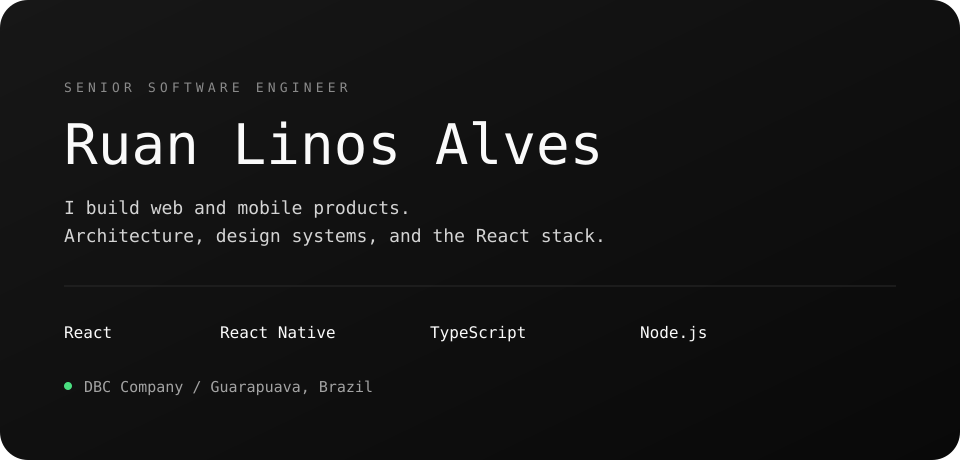

  

  <a href="https://ruanlinos.dev">website</a>
  &nbsp;&nbsp;/&nbsp;&nbsp;
  <a href="https://www.linkedin.com/in/linosruan">linkedin</a>
  &nbsp;&nbsp;/&nbsp;&nbsp;
  <a href="https://x.com/LinosRuan">x</a>

  
  &nbsp;
  

